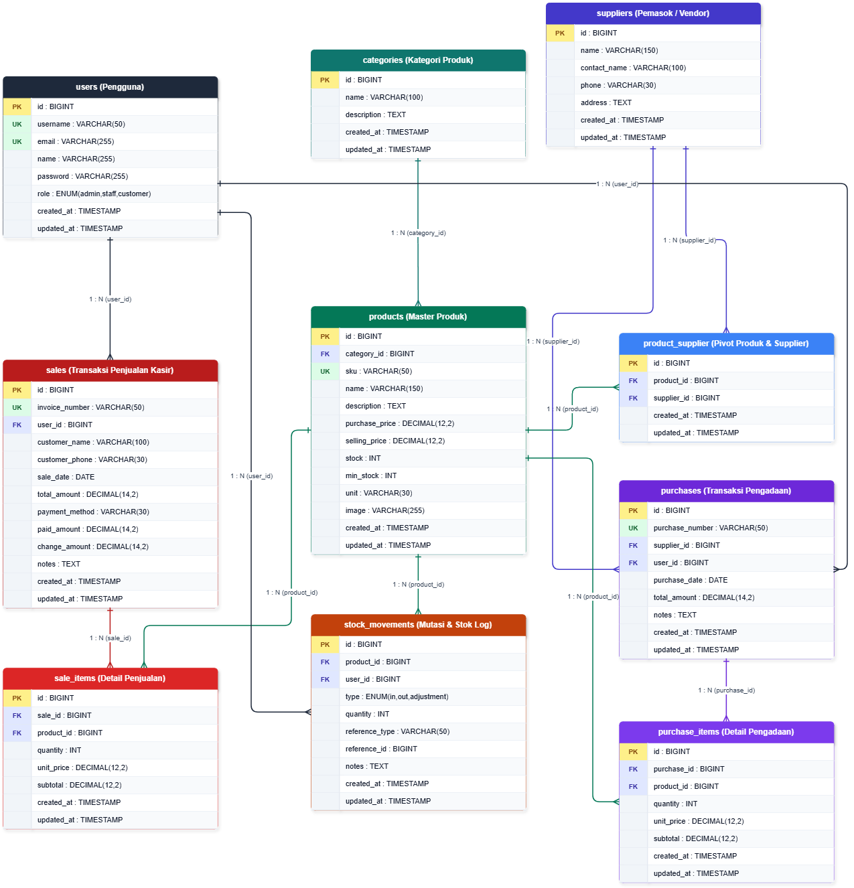
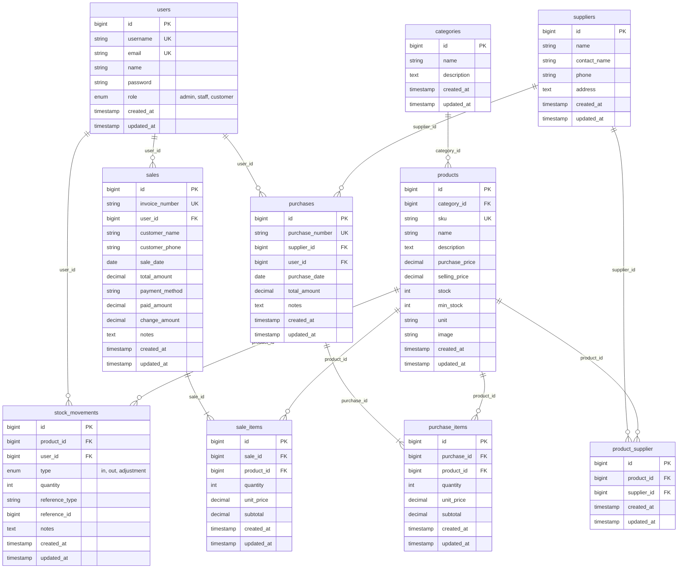
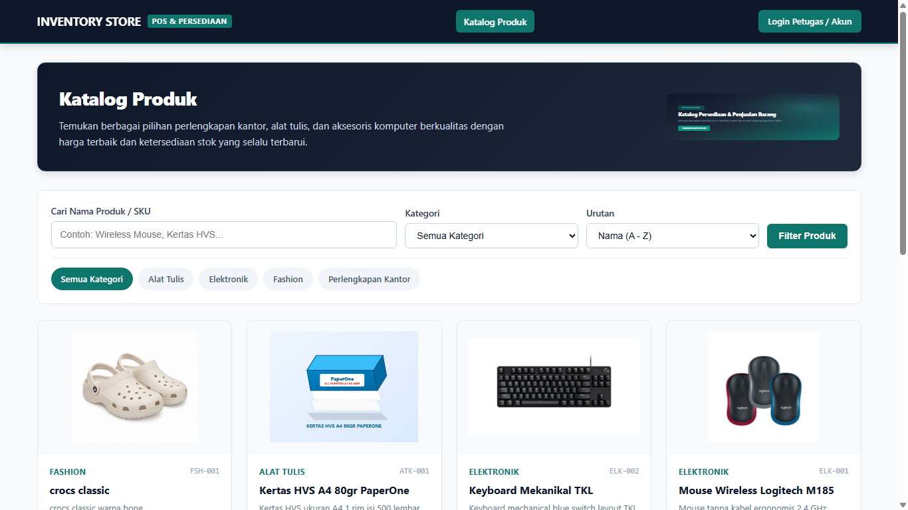
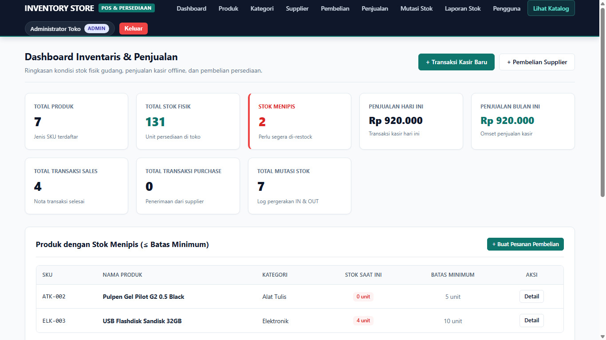
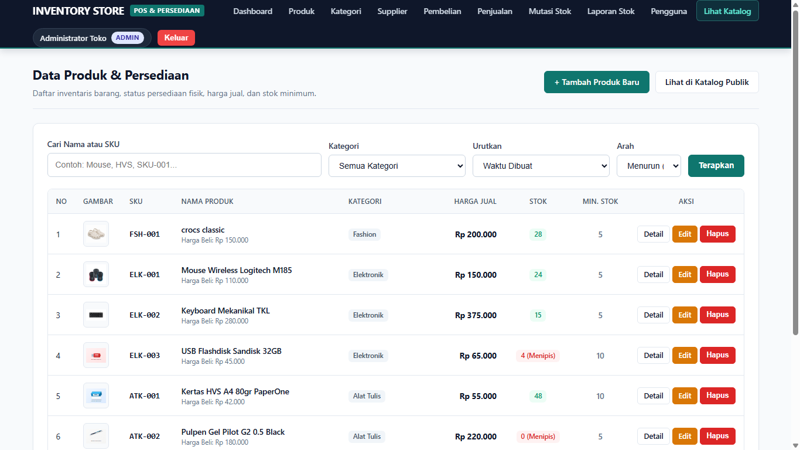
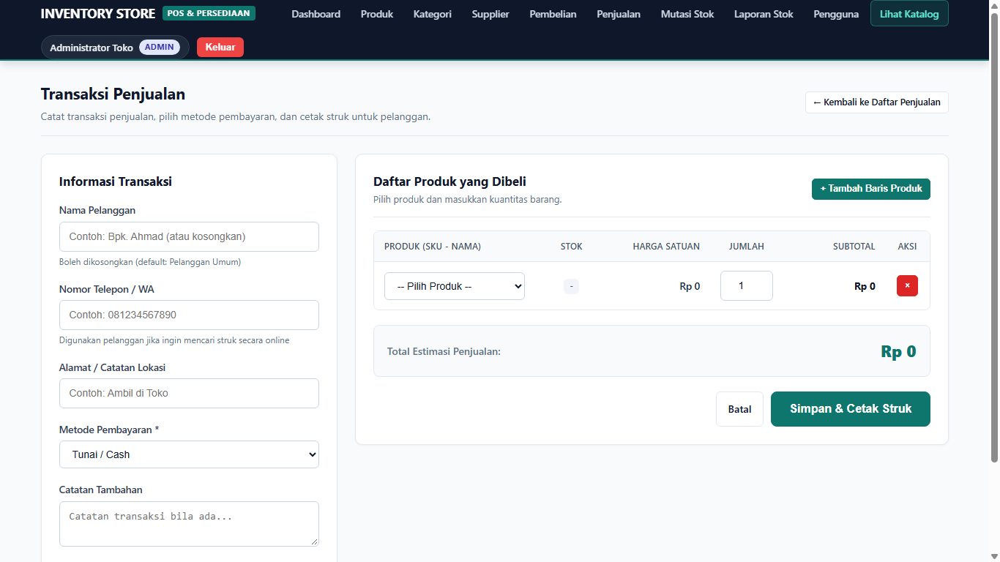
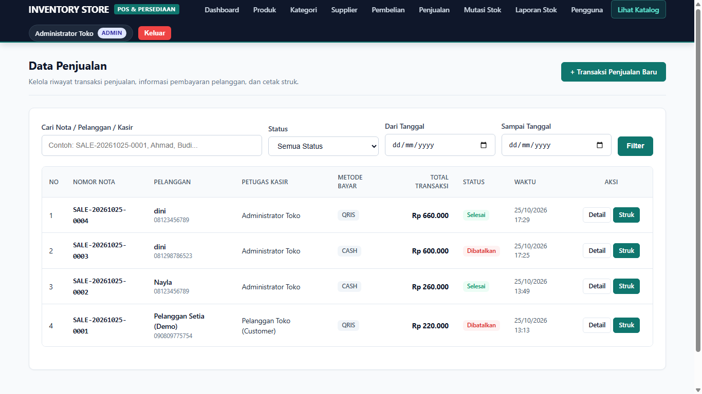
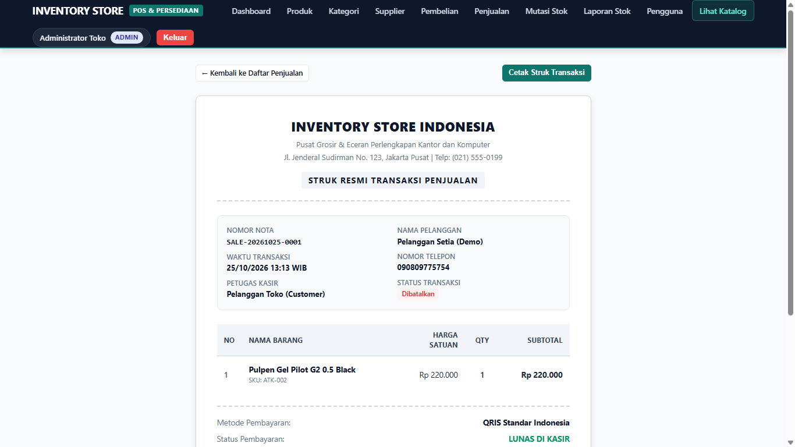
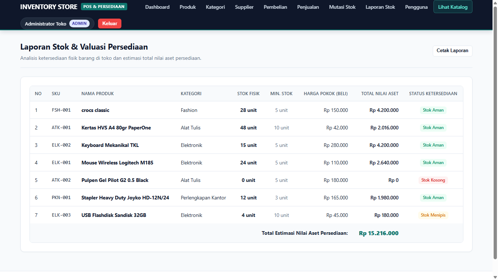
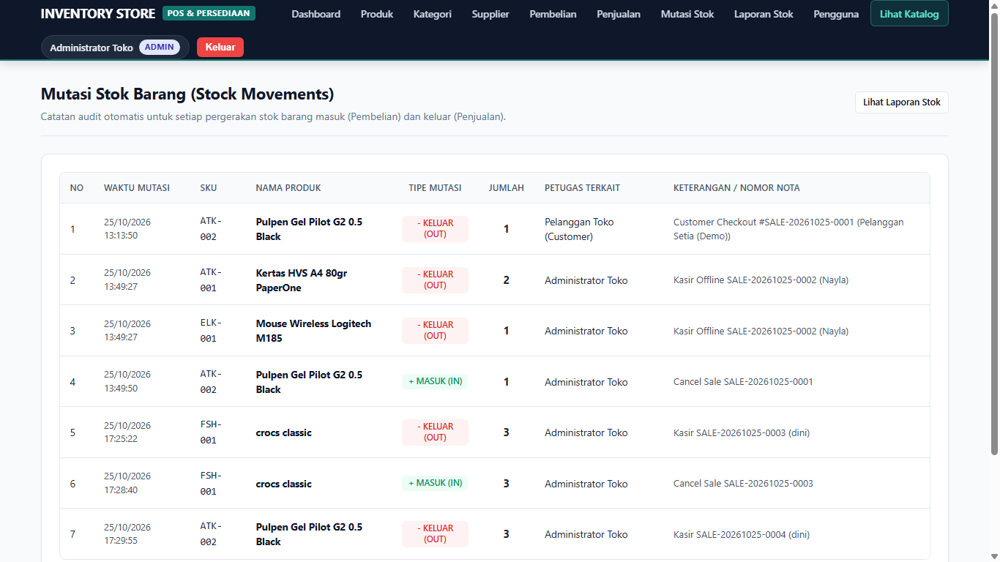

# Laravel Project: Inventory & Sales Management System

Aplikasi bisnis terintegrasi berbasis web untuk manajemen persediaan barang (inventaris), transaksi kasir penjualan offline, transaksi pembelian supplier (*stock-in*), mutasi stok, laporan valuasi persediaan, serta katalog produk publik berbasis Laravel, MySQL, dan Eloquent ORM.

Proyek ini dibangun dan disempurnakan untuk memenuhi seluruh spesifikasi sistem informasi inventaris dan ritel modern.

---

## 1. Project Overview & Skenario Bisnis

Sebuah usaha distribusi dan toko retail mengelola produk, pemasok (supplier), pembelian stok, dan penjualan melalui kasir toko fisik. Sistem ini mengintegrasikan seluruh operasional bisnis dan katalog etalase dengan aturan bisnis (*business logic*) utama:

- **Konsistensi Stok Otomatis:** Stok produk bertambah secara atomik saat pembelian berhasil, dan berkurang saat penjualan kasir offline berhasil.
- **Pencegahan Overselling:** Penjualan divalidasi ketat terhadap stok fisik yang tersedia. Transaksi otomatis ditolak jika stok tidak mencukupi.
- **Server-Side Pricing:** Total penjualan dan subtotal dihitung murni di server menggunakan harga produk resmi dari database untuk mencegah manipulasi data dari client.
- **Atomic Database Transactions:** Seluruh operasi header, items, dan mutasi stok diikat dalam `DB::transaction()` dengan `Product::lockForUpdate()` untuk mencegah *concurrency issues* / *race condition*.
- **Role-Based Access Control (RBAC):** Memisahkan wewenang 3 role utama:
  1. **Admin / Owner:** Akses penuh master data, laporan, manajemen user, dan pembatalan transaksi.
  2. **Staff / Kasir:** Transaksi pembelian supplier, kasir penjualan offline, melihat produk, kategori, supplier, mutasi stok, dan laporan stok.
  3. **Customer / Publik:** Melihat katalog etalase produk offline, memeriksa ketersediaan stok fisik real-time, dan panduan pembelian langsung di kasir toko offline.

---

## 2. Persyaratan Sistem (Requirements)

Sebelum memulai instalasi, pastikan komputer/server Anda memenuhi persyaratan berikut:

- **PHP:** Versi 8.2 atau lebih baru
- **Ekstensi PHP Aktif:** `pdo_mysql`, `pdo_sqlite`, `mbstring`, `openssl`, `tokenizer`, `xml`, `ctype`, `json`, `curl`, `fileinfo`
- **Composer:** Versi 2.x
- **Database:** MySQL / MariaDB (minimal versi 5.7 atau 8.0, e.g. via XAMPP, Laragon, atau MySQL Server mandiri)
- **Web Browser:** Chrome, Edge, Firefox, atau Safari versi modern

---

## 3. Langkah Instalasi Lengkap & Setup Lingkungan

Ikuti langkah-langkah instalasi berikut secara berurutan untuk menjalankan proyek pada environment bersih (*clean setup*):

### Langkah 1: Masuk ke Direktori Proyek
Buka terminal (Command Prompt, PowerShell, atau Git Bash), lalu arahkan ke folder proyek:
```bash
cd C:\punya-nayla-jlegg\inventory-laravel\inventory-laravel
```

### Langkah 2: Install Dependensi PHP (Composer)
Jalankan perintah berikut untuk mengunduh seluruh dependensi framework:
```bash
composer install
```

### Langkah 3: Siapkan File Environment (`.env`)
Salin file konfigurasi contoh `.env.example` menjadi `.env`:
- **Windows (Command Prompt / PowerShell):**
  ```bash
  copy .env.example .env
  ```
- **Linux / macOS / Git Bash:**
  ```bash
  cp .env.example .env
  ```

### Langkah 4: Buat Database di MySQL
1. Buka aplikasi MySQL Anda (misal: aktifkan **MySQL** di kontrol panel **XAMPP** atau **Laragon**).
2. Buka **phpMyAdmin** (`http://localhost/phpmyadmin`) atau terminal MySQL, lalu buat database baru bernama:
   ```sql
   CREATE DATABASE inventory_laravel;
   ```
3. Pastikan konfigurasi koneksi pada file `.env` sudah sesuai:
   ```env
   DB_CONNECTION=mysql
   DB_HOST=127.0.0.1
   DB_PORT=3306
   DB_DATABASE=inventory_laravel
   DB_USERNAME=root
   DB_PASSWORD=
   ```
   *(Sesuaikan `DB_USERNAME` dan `DB_PASSWORD` jika MySQL Anda menggunakan sandi).*

### Langkah 5: Generate Application Key
Jalankan perintah ini untuk membuat kunci enkripsi unik aplikasi:
```bash
php artisan key:generate
```

### Langkah 6: Buat Symlink Storage (Penting untuk Gambar Produk)
Jalankan perintah berikut agar gambar produk di folder storage dapat diakses oleh browser:
```bash
php artisan storage:link
```

### Langkah 7: Jalankan Migrasi & Data Seeder Awal
Jalankan migrasi tabel database dan masukkan data awal (pengguna, kategori, produk, supplier, dan transaksi contoh):
```bash
php artisan migrate:fresh --seed
```

### Langkah 8: Jalankan Server Lokal
Nyalakan local development server Laravel:
```bash
php artisan serve
```

Aplikasi siap diakses melalui browser pada alamat:  
👉 **`http://127.0.0.1:8000`** (atau `http://localhost:8000`)

---

## 4. Akun Demo & Hak Akses (Demo Accounts)

Database seeder telah menyediakan 3 akun demo siap pakai untuk menguji seluruh role:

| Role | Username | Email | Password | Hak Akses Utama |
|---|---|---|---|---|
| **Admin / Owner** | `admin` | `admin@inventory.test` | `admin123` | Akses penuh: Master data (CRUD Produk, Kategori, Supplier), Kelola Pengguna, Batalkan Transaksi, Mutasi Stok, dan Laporan. |
| **Staff / Kasir** | `staff` | `staff@inventory.test` | `staff123` | Akses operasional: Transaksi kasir offline, pengadaan barang supplier, pantau stok, mutasi stok, dan laporan stok. |
| **Customer** | `customer` | `customer@inventory.test` | `customer123` | Akses katalog publik: Melihat ketersediaan stok fisik produk dan informasi panduan belanja offline. |

> **Catatan:** Form login mendukung autentikasi fleksibel, Anda dapat login menggunakan **Username** maupun **Email**.

---

## 5. Entity Relationship Diagram (ERD) & Struktur Database

### Skema Visual Diagram ERD


### File Sumber ERD untuk Draw.io
Proyek ini telah dilengkapi file ERD siap pakai:
1. **`erd-inventory.drawio`**: Buka langsung di [app.diagrams.net](https://app.diagrams.net) (*File &rarr; Open From &rarr; Device*). Tampilan tabel 2-kolom rapi, bebas tag HTML bocor, dan badge kunci (`PK`, `FK`, `UK`) berwarna tajam.
2. **`erd-inventory.sql`**: Skema DDL resmi yang bisa langsung di-import di draw.io via menu **+ / Arrange &rarr; Insert &rarr; Advanced &rarr; SQL**.

### Kode Diagram ERD (Mermaid)



---

## 6. Fitur Unggulan Sistem

1. **Konsistensi Navbar & Desain Visual:**
   - Desain profesional berbasis tema *Corporate Slate Navy* (`#0f172a`) dan palet clean neutral (`#f8fafc`).
   - Tampilan navbar seragam dan responsif yang otomatis menyesuaikan menu berdasarkan status autentikasi dan role pengguna (Admin, Staff, Customer, dan Guest).
   - Bebas emoji tidak perlu pada antarmuka untuk menjaga estetika bisnis yang rapi dan profesional.

2. **Katalog Produk & Panduan Belanja Offline:**
   - Halaman etalase publik (`/` atau `/catalog`) yang menyajikan kartu produk dengan gambar rapi dan rasio seragam.
   - Indikator status stok fisik real-time (Tersedia, Tersisa Sedikit, Habis).
   - Informasi pembelian offline di kasir toko disajikan secara wajar dan informatif.

3. **Transaksi Kasir Penjualan Offline:**
   - Antarmuka pencatatan kasir (`/sales/create`) dengan penambahan item dinamis, validasi stok live, kalkulasi otomatis subtotal, total, uang bayar, dan kembalian.
   - Pencatatan identitas pelanggan serta metode pembayaran kasir toko offline (Tunai / Cash).

4. **Cetak Struk Transaksi Resmi:**
   - Format struk transaksi kasir resmi (`/sales/{sale}/receipt`) yang siap dicetak langsung via printer kasir/thermal atau A4 (`window.print()`).

5. **Manajemen Pengguna (User Management CRUD):**
   - Hak istimewa Admin untuk menambah, melihat, mengedit profil/role, dan menghapus pengguna.
   - Dilengkapi proteksi keamanan (*self-deletion guard* dan *self-role-demotion guard*) agar Admin yang sedang login tidak dapat menghapus atau menurunkan rolenya sendiri.

6. **Integritas Relasi Data:**
   - Pencegahan penghapusan produk yang sudah memiliki riwayat transaksi (pembelian, penjualan, mutasi).
   - Pencegahan penghapusan supplier yang memiliki riwayat pengadaan barang.

---

## 7. Tangkapan Layar Antarmuka Aplikasi (Screenshots)

Berikut adalah pratinjau tampilan sistem yang telah diperbarui dan siap digunakan:

| Katalog Produk Toko Offline | Dashboard Admin & Ringkasan |
| :---: | :---: |
|  |  |

| Master Produk & Inventaris | Form Transaksi Penjualan (Cash) |
| :---: | :---: |
|  |  |

| Riwayat Data Penjualan | Format Cetak Struk Kasir Resmi |
| :---: | :---: |
|  |  |

| Laporan Valuasi & Ringkasan Stok | Mutasi & Log Audit Pergerakan Stok |
| :---: | :---: |
|  |  |

---

## 8. Pengujian Otomatis (Automated Test Suite)

Aplikasi telah lulus seluruh pengujian otomatis dengan total **31 skenario pengujian dan 162 assertions (100% PASS)**:

```bash
php artisan test
```

### Hasil Log Pengujian:
```text
PASS  Tests\Unit\ExampleTest
✓ that true is true                                                                                            

PASS  Tests\Feature\CustomerShopTest
✓ customer can view catalog storefront and product detail                                                      
✓ customer sees offline purchase guide                                                                         
✓ customer can search and filter products                                                                      
✓ receipt lookup redirects to catalog                                                                          
✓ customer can view printable official receipt                                                                 
✓ cashier offline sales flow reduces stock and creates receipt                                                 

PASS  Tests\Feature\ExampleTest
✓ root route is accessible                                                                                     
✓ customer shop is accessible                                                                                  
✓ login page is accessible                                                                                     

PASS  Tests\Feature\InventorySystemTest
✓ guest cannot access dashboard and is redirected to login                                                     
✓ login fails with invalid credentials                                                                         
✓ user can login with valid credentials                                                                        
✓ product sku must be unique and prices must be positive                                                       
✓ purchase transaction increases stock atomically                                                              
✓ sale transaction decreases stock atomically                                                                  
✓ sale fails when stock is insufficient without data corruption                                                
✓ transaction atomicity rolls back if any item fails                                                           
✓ staff cannot access admin functions                                                                          
✓ search and filter yields correct data                                                                        
✓ admin can cancel sale and restore stock                                                                      
✓ cannot delete product used in transaction                                                                    
✓ cannot delete supplier with purchases                                                                        
✓ admin can create and manage users                                                                            
✓ staff can view categories and suppliers list                                                                 
✓ customer role is redirected to shop when accessing dashboard                                                 
✓ admin and staff can see and search customer orders                                                           

PASS  Tests\Feature\RolePermissionMatrixTest
✓ admin has full access to all modules                                                                         
✓ staff has restricted access                                                                                  
✓ customer role is directed to catalog                                                                         
✓ guest can access catalog                                                                                     

Tests:    31 passed (162 assertions)
Duration: 3.12s
```

---

## 9. Panduan Troubleshooting Singkat

| Permasalahan | Solusi |
|---|---|
| **Gambar produk tidak muncul / broken** | Jalankan `php artisan storage:link` untuk menghubungkan folder storage ke folder public. |
| **Access denied for user 'root'@'localhost'** | Periksa konfigurasi `DB_USERNAME` dan `DB_PASSWORD` di file `.env`. |
| **Target class [X] does not exist** | Jalankan `composer dump-autoload` lalu `php artisan optimize:clear`. |
| **Vite / CSS styling tidak terbaca** | Pastikan file asset di public telah terhubung, atau jalankan `php artisan optimize:clear`. |
| **No application encryption key has been specified** | Jalankan perintah `php artisan key:generate`. |
